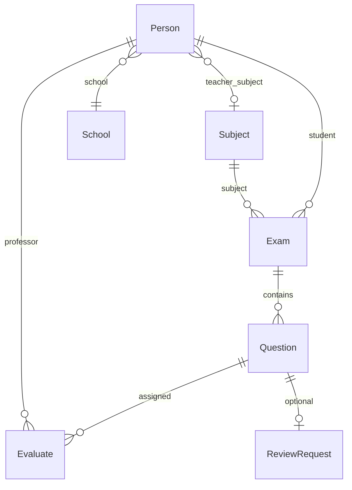

# EMS — Exam Management System

Subsistema de gestão de exames nacionais para a candidatura DEI (BL174/2025).

**Stack:** Spring Boot 3 · PostgreSQL · Vue 3 · Vuetify 3

**Estrutura do repositório:**

```
src/
├── backend/          # API REST (Java 21, Maven)
├── frontend/         # SPA (Vite + Vue 3)
└── docker-compose.yml
```

---

## Pré-requisitos

- [Java 21](https://www.oracle.com/java/technologies/downloads/)
- [Maven 3.x](https://maven.apache.org/download.cgi)
- [Node.js 18+](https://nodejs.org/) (recomendado: nvm)
- [Docker](https://www.docker.com/) + Docker Compose

**Portas usadas por defeito:**

| Serviço    | Porta |
|------------|-------|
| PostgreSQL | 7654  |
| Backend    | 8080  |
| Frontend   | 8081  |

---

## Configuração e execução local

### 1. Base de dados (Docker)

```bash
cd src
docker compose up -d
```

Parâmetros em `src/docker-compose.yml`: base `emsdb`, utilizador `postgres`, password `postgres`, porta host `7654`.

### 2. Backend

```bash
cp backend/src/main/resources/application.properties.example \
   backend/src/main/resources/application.properties

cd backend
mvn spring-boot:run
```

A API fica disponível em `http://localhost:8080`.

**Notas:**

- `spring.jpa.hibernate.ddl-auto=create` recria o schema em cada arranque (ambiente de desenvolvimento). Os seeders voltam a popular a BD automaticamente.
- Ficheiros de exames e fragmentos são guardados em `uploads/` (relativo ao diretório de trabalho do backend). Configurável via `ems.uploads.dir`.
- A chave JWT em `application.properties.example` é apenas para desenvolvimento. Para produção, gere uma chave Base64 própria (`security.jwt.secret-key`).

### 3. Frontend

```bash
cd frontend
cp example.env .env
npm install
npm run dev
```

A aplicação abre em `http://localhost:8081` (definido em `VITE_PORT` no `.env`).

O frontend comunica com a API via `VITE_ROOT_API=http://localhost:8080`.

---

## Dados de teste (seed)

No arranque do backend, dois componentes preenchem a base de dados:

1. **`DataInitializer`** — escolas, disciplinas, utilizadores (se ainda não existirem).
2. **`ExamDemoSeeder`** — 9 exames de demonstração (um por estado de workflow, excepto `REVIEW_CLOSED`, que é transitório). Controlado por `ems.seed.demo-exams` em `application.properties`:

| Valor | Uso |
|-------|-----|
| `true` (defeito) | Pessoas + 9 exames demo (validar UI nos vários estados) |
| `false` | Só pessoas/escolas/disciplinas — testar o workflow do zero |

Alterar a propriedade e reiniciar o backend (`ddl-auto=create` recria a BD).

### Contas principais

| Email | Password | Perfil |
|-------|----------|--------|
| admin@dei.tecnico.ulisboa.pt | admin123 | Administrador |
| staff@dei.tecnico.ulisboa.pt | staff123 | Funcionário (ESLFB) |
| teacher@dei.tecnico.ulisboa.pt | teacher123 | Professor FQ-A (ESRDL) |
| carlos.mendes@dei.tecnico.ulisboa.pt | teacher123 | Professor MAT-A (ESLFB) |
| sofia.ribeiro@dei.tecnico.ulisboa.pt | teacher123 | Professor BG (ESLFB) |
| student@dei.tecnico.ulisboa.pt | student123 | Aluno (ESLFB) |
| aluno2@ … aluno10@dei.tecnico.ulisboa.pt | student123 | Alunos |

### Seed base

- **Escolas:** ESLFB (Oeiras), ESRDL (Lisboa)
- **Disciplinas:** POR, MAT-A, FQ-A, BG
- **10 alunos**, **3 professores**, **1 administrador**, **1 funcionário**

### Exames de demo (por estado)

| Aluno | Estado |
|-------|--------|
| student@ | UPLOADED |
| aluno2@ | SEGMENTED |
| aluno3@ | LOCKED |
| aluno4@ | IN_GRADING |
| aluno5@ | GRADED |
| aluno6@ | GRADES_PUBLISHED |
| aluno7@ | RELEASED |
| aluno8@ | REVIEW_GRADING |
| aluno10@ | FINAL |

Contas úteis para testar fluxos: **aluno6@** (notas publicadas), **aluno7@** (PDF disponível), **aluno8@** (revisão em curso), **carlos.mendes@** (inbox com correções pendentes).

---

## Decisões de arquitetura

- **Organização backend:** pacotes por domínio (`person`, `school`, `subject`, `exam`, `question`, `evaluate`, `reviewrequest`), cada um com entity, repository, service, controller e DTOs — alinhado com o starter do projecto.
- **Autenticação:** JWT stateless; cada `Person` tem um `PersonType` que mapeia para permissões em `RolePermissions`. O frontend consulta `auth.hasPermission()` para mostrar rotas e acções.
- **Autorização:** anotações `@PreAuthorize` nos controllers + validações de negócio nos services (ex.: funcionário só acede a exames da sua escola).
- **Erros:** excepções de negócio via `DEIException` → `CustomExceptionHandler` devolve JSON uniforme (`message`, `code`). No frontend, alerta global + `RemoteService.consumeError()` evita mensagens duplicadas.
- **Ficheiros:** PDFs completos e imagens de fragmentos em disco; a BD guarda apenas paths (sem BLOBs).
- **Workflow de exames:** estados explícitos na entidade `Exam`. **Publicar notas** (`GRADES_PUBLISHED`, inicia prazo de revisão de 48 h) é separado de **disponibilizar a prova** (`RELEASED`, aluno vê o PDF).
- **Revisão:** job agendado `ReviewWindowCloser` fecha prazos expirados; pedidos redistribuem-se como `Evaluate` tipo `REVIEW`; nota final híbrida (nota de revisão se existir, senão nota inicial).
- **Segmentação:** renderização do PDF no browser com pdf.js; modo páginas inteiras ou recortes manuais (bounding boxes); confirmação envia PNGs + cotações via multipart para o backend.
- **Seed:** `DataInitializer` (`CommandLineRunner`) corre primeiro; `ExamDemoSeeder` usa `ApplicationReadyEvent` para garantir que pessoas e escolas já existem.
- **Estatísticas:** agregações no backend; visualização com Chart.js / vue-chartjs no frontend.

---

## Controlo de acessos (RBAC)

O sistema usa **JWT stateless** com permissões derivadas do `PersonType` ([`RolePermissions`](src/backend/src/main/java/pt/ulisboa/tecnico/rnl/dei/ems/security/RolePermissions.java)).

**Camadas de protecção:**

1. **API** — `@PreAuthorize` nos controllers (ex.: só admin bloqueia/distribui exames).
2. **Negócio** — regras por escola nos services (ex.: funcionário só vê exames da sua escola; professor só corrige atribuições próprias).
3. **Frontend** — guard de rotas (`meta.permission`) + `auth.hasPermission()` nos menus e acções.

### Permissões por perfil (resumo)

| Perfil | Acesso principal |
|--------|------------------|
| **Administrador** | Tudo (CRUD global, lock, distribuição, impersonação); dashboard de estatísticas global |
| **Funcionário** | Pessoas e exames da **sua escola**; upload, segmentação, publicar/libertar notas; criar/editar **apenas alunos** da escola; estatísticas da escola |
| **Professor** | Inbox de correcções (sem identidade do aluno); listagem de pessoas **da sua escola** (leitura) |
| **Aluno** | Consulta das **próprias** provas e notas; pedidos de revisão |

### Regras específicas

- **Funcionário + pessoas:** na listagem só vê pessoas da sua escola (alunos, professores e funcionários). Pode criar/editar só alunos (`STUDENT`) com `schoolCode` igual à sua escola. Não pode criar administradores, professores ou funcionários.
- **Professor + pessoas:** na listagem só vê pessoas da sua escola; sem escola associada, a lista fica vazia.
- **Funcionário + perguntas:** `GET /questions` filtrado pela escola do aluno do exame.
- **Professor + correcção:** `EvaluateInboxDto` não expõe dados do aluno; nota/imagem só acessíveis na atribuição do professor autenticado.
- **Estatísticas:** dashboard (`GET /statistics`) para admin (global) e funcionário (escola); exames por estado, média por disciplina, progresso de correção e volume de revisões. Professores não têm `STATISTICS_READ`.
- **Aluno:** sem acesso à listagem de pessoas (`PERSON_READ` removido).

### Testes automatizados

Casos representativos em [`RbacSecurityTest`](src/backend/src/test/java/pt/ulisboa/tecnico/rnl/dei/ems/security/RbacSecurityTest.java). Executar:

```bash
cd src/backend && mvn test
```

---

## Modelo de dados



| Entidade | Campos principais | Relações |
|----------|-------------------|----------|
| **School** | name, code, region | — |
| **Subject** | name, code | — |
| **Person** | name, email, password (BCrypt), type | N:1 School; professor N:1 Subject |
| **Exam** | state, path, finalScore, reviewDeadline, consultationRequested | N:1 Person (aluno), N:1 Subject |
| **Question** | number, maxScore, path | N:1 Exam |
| **Evaluate** | grade, state, type (INITIAL / REVIEW) | N:1 Person (professor), N:1 Question |
| **ReviewRequest** | justification, status, createdAt | N:1 Question (único por pergunta) |

---

## Estados do exame

Fluxo principal (por ordem):

```
UPLOADED → SEGMENTED → LOCKED → IN_GRADING → GRADED
  → GRADES_PUBLISHED → RELEASED → [REVIEW_CLOSED] → REVIEW_GRADING → FINAL
```

- **UPLOADED** — PDF carregado pelo funcionário.
- **SEGMENTED** — dividido em perguntas (fragmentos PNG).
- **LOCKED** — submissões fechadas; pronto para distribuição. Novos uploads só voltam a ser permitidos quando não houver exames a meio do ciclo (estados entre `LOCKED` e `REVIEW_GRADING`); exames só em `UPLOADED` / `SEGMENTED` / `FINAL` deixam as submissões abertas.
- **IN_GRADING** — fragmentos atribuídos a professores.
- **GRADED** — todas as correções iniciais concluídas; nota final calculada.
- **GRADES_PUBLISHED** — notas visíveis ao aluno; prazo de revisão activo.
- **RELEASED** — aluno pode consultar o PDF da prova.
- **REVIEW_CLOSED** — prazo de revisão expirou com pedidos pendentes (estado transitório; passa rapidamente a REVIEW_GRADING).
- **REVIEW_GRADING** — fragmentos em revisão atribuídos a professores.
- **FINAL** — nota definitiva (híbrida inicial + revisão).

---

## Acesso à base de dados

```bash
psql -h localhost -p 7654 -U postgres emsdb
```

Password: `postgres`
